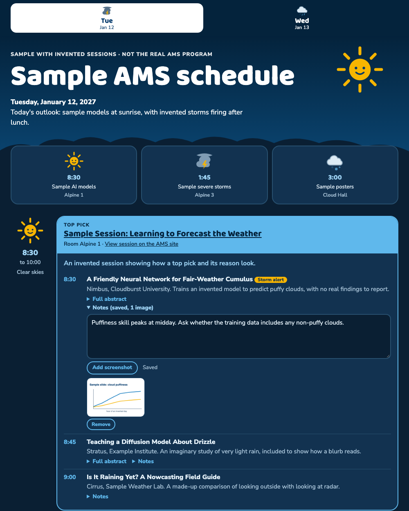

# AMS schedule generator

Have an AI agent build your personal schedule for the [AMS Annual Meeting](https://annual.ametsoc.org/) (Denver, January 10–14, 2027). It asks what you're interested in, reads the program, and makes a cute weather-themed page with day tabs, a top pick for each time slot, alternates, a summary and expandable full abstract for every talk, links to each session on the AMS site, relevant posters, and a place under each talk for your own notes and screenshots.

The picture and `example/` use invented sessions. Your page will use the real program.

## How to use it

You need Python 3.9 or newer and an AI coding agent that can read files and run commands, such as Claude Code.

1. Download this repo and open the folder in your agent.
2. Tell it: **"Read AGENTS.md and build my AMS schedule."**
3. Answer its questions about your interests, availability and preferences.
4. Open `my-ams-schedule.html` when it's done. It's one file, so you can email it to yourself and use it on your phone.

Notes save in the browser you're using, on that device only. Paste, drop or choose screenshots under any talk, and use **Back up notes** at the bottom of the page to keep a copy or move notes to another device. Open the page in a regular browser rather than an email preview, where storage may not last, and keep the file's name and location the same. Clearing browser data erases notes that haven't been backed up.

Downloading the program takes roughly an hour the first time, because the AMS API allows about one request per second. It runs in the background, so you can leave it. Your interests, the downloaded program and your finished page all stay on your machine, unless your agent sends them to its AI provider as part of its normal work. If you're using it for work, check your organization's AI policy.

Check rooms and times against the [official program](https://ams.confex.com/ams/107ANNUAL/meetingapp.cgi) before relying on them, because they can change, and AI summaries can be wrong.

## What's here

| File | Purpose |
|---|---|
| `AGENTS.md` | The agent's instructions: interview, picking rules, format |
| `harvest.py` | Downloads the public program |
| `digest.py` | Turns the program into text the agent can read |
| `draft.py` | Makes a rough starting schedule from keyword scores |
| `build.py` | Validates the schedule, checks it against the program and builds the page |
| `template.html` | The weather theme |

## Credits

The approach to the Confex API comes from David John Gagne's MIT-licensed [amsai2027](https://github.com/djgagne/amsai2027). Program content belongs to AMS and its authors, so this repo downloads it and doesn't include a copy. This project isn't affiliated with or endorsed by the American Meteorological Society, and the colors only approximate its palette.

MIT licensed. See [LICENSE](LICENSE).
